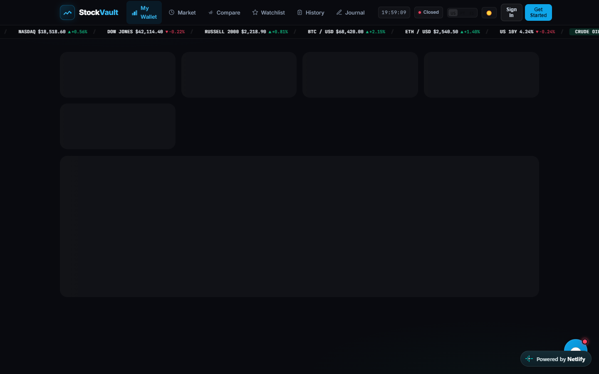

# 📈 StocksVault — Financial Portfolio & Equity Analytics Tracker

[](https://stocksvault.netlify.app)
[](https://angular.dev)
[](https://stocksvault.netlify.app)
[](https://stocksvault.netlify.app)

> **Live Application:** [https://stocksvault.netlify.app](https://stocksvault.netlify.app)  
> **Author:** Fábio Júnior Fernandes Silva — BSc in Web Multimedia Development @ IPCA (Portugal)



---

## 🌟 Overview & How It Works

**StocksVault** is a single-page financial portfolio and equity analytics web application built with **Angular** and **TypeScript**. It allows users to monitor stock market quotes, track portfolio asset allocations, compare multi-ticker performance metrics, and manage custom watchlists in real time.

### Key Capabilities
1. **Portfolio Allocation & Valuation Dashboard**:
   - Tracks total portfolio value, daily gain/loss percentages, position weights, and cost-basis calculations.
2. **Interactive Watchlists & Equity Comparison**:
   - Search and filter global equities, compare key valuation multiples side by side, and inspect historical price trends.
3. **Reactive Angular Architecture**:
   - Modular Angular components, strongly typed TypeScript interfaces, and reactive HTTP services with clean error boundaries.

---

## 🛠️ Tech Stack & Architecture

| Layer | Technology |
| :--- | :--- |
| **Framework** | Angular, TypeScript, RxJS |
| **UI & Data Tables** | High-density responsive financial tables & interactive charts |
| **API Layer** | Asynchronous REST API services |
| **Deployment** | Netlify CI/CD (`stocksvault.netlify.app`) |

---

## 🚀 Running Locally

```bash
git clone https://github.com/FabioSilva32/StockVault.git
cd StockVault
npm install
npm start
```
